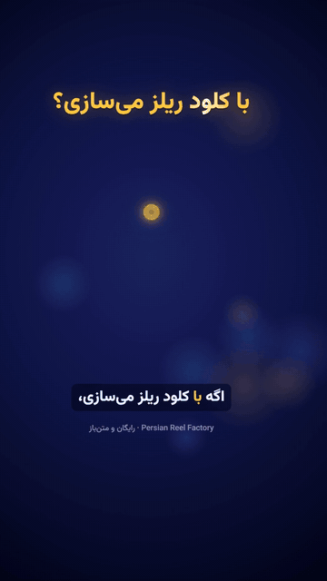

<div dir="rtl">

# 🎬 Persian Reel Factory · کارخانه‌ی ریلز فارسی

**یک اسکیل رایگان برای Claude Code که ریلز فارسیِ حرفه‌ای را با نصفِ توکن و دو برابر سرعت می‌سازد.**

<p align="center">
  
  <br>
  <a href="docs/demo.mp4">▶️ ویدیوی کامل با صدا (۵۰ ثانیه)</a>
</p>

ریلی که داخل این مخزن می‌بینید را خودِ همین اسکیل ساخته است: صداگذاری فارسی، زیرنویسِ کلمه‌به‌کلمه، موشن‌گرافیک، موزیک و افکت، همه داخل کادر امن اینستاگرام.

| | بدون اسکیل | با Persian Reel Factory |
|---|---|---|
| توکن برای هر ریل | ۱۰۰٪ | **حدود ۵۰٪** |
| زمان ساخت | حدود ۱ ساعت | **حدود ۲۵ تا ۳۰ دقیقه** |
| ظاهر | هر بار متفاوت | **یک‌دست و حرفه‌ای** |
| کادر امن، زیرنویس، موزیک | دستی | **خودکار** |

## چرا اینقدر صرفه‌جویی می‌کند؟
Claude دیگر هر بار از صفر کد نمی‌نویسد. پس‌زمینه، حرکت دوربین، شماره‌گذاری بخش‌ها، زیرنویس کارائوکه، کادر امن و میکس صدا از قبل در قالب آماده‌اند. برای هر ریل فقط **سه فایل کوچک** نوشته می‌شود: متن، زمان‌بندی و تصویرِ هر بخش. ابزارهای آماده هم کارهای تکراری را بدون خواندنِ فایل‌های بزرگ انجام می‌دهند.

## چه چیزهایی داخلش هست
- 🧩 قالب Remotion با ۱۰۸۰×۱۹۲۰ و ۶۰ فریم: هوک، بخش‌های شماره‌دار، دعوت به اقدام
- 🎙️ صداگذاری فارسی با ElevenLabs (یا هر صدای دیگر)
- 📝 زیرنویس کلمه‌به‌کلمه با زمان‌بندی واقعی Whisper
- 🎵 موزیک و افکت ساخته‌شده با کد (بدون مشکل کپی‌رایت)، میکس‌شده روی -14 LUFS
- 📱 رعایت کادر امن اینستاگرام + نسخه‌ی راهنما برای چک کردن
- 🔥 راهنمای وایرال: موضوع، هوک، دعوت به اقدام و کپشن

## نصب (۲ دقیقه)
دو راه دارد؛ هرکدام برایتان راحت‌تر بود:

**روش ۱ — پلاگین Claude Code (همه‌ی پلن‌ها):** داخل Claude Code بنویسید:

</div>

```
/plugin marketplace add sinashot/persian-reel-factory
/plugin install persian-reel-factory@persian-reel-factory
```

<div dir="rtl">

**روش ۲ — آپلود مستقیم در claude.ai (مناسب پلن رایگان):** دکمه‌ی سبز «Code → Download ZIP» بالای این صفحه را دانلود نکنید — آن کل مخزن را می‌دهد و claude.ai ردش می‌کند. به‌جایش:
1. همین فایل آماده را دانلود کنید: **[persian-reel-factory-skill.zip](https://github.com/sinashot/persian-reel-factory/raw/main/dist/persian-reel-factory-skill.zip)**
2. در claude.ai: Settings → Capabilities → Skills → **Upload a skill** → همان فایل را انتخاب کنید.

یا دستی: پوشه‌ی `skills/persian-reel-factory` را در `~/.claude/skills/` کپی کنید.

بعد فقط بگویید: **«یه ریلز درباره‌ی ... بساز»**. اسکیل خودش پروژه را آماده می‌کند (`npm install` و `pip install`) و مرحله‌به‌مرحله جلو می‌رود.

**پیش‌نیازها:** Node.js نسخه‌ی ۱۸ به بالا، Python نسخه‌ی ۳.۱۰ به بالا، و برای صدا یک کلید ElevenLabs (پلن رایگان هم کافی است). کارت گرافیک NVIDIA زیرنویس را سریع‌تر می‌کند ولی لازم نیست.

</div>

---

## English

**Persian Reel Factory** is a free Claude Code skill (plugin) that makes 30–60 s vertical reels with a Persian voiceover, word-by-word karaoke captions, motion graphics, music and SFX, rendered from code with [Remotion](https://www.remotion.dev).

- **About half the tokens, about twice as fast:** the template already owns the backdrop, camera moves, numbered chapters, captions, safe zone and audio pipeline. Each reel is three small files: the script, the cue times and one visual per chapter.
- **Pipeline:** `lines.json` → TTS (ElevenLabs `eleven_v3`, Persian) → beat-grid alignment → faster-whisper word times → `cues.json` → synthesized score + SFX ducked under the voice (-14 LUFS) → Remotion render → remux.
- **Instagram-safe:** every word stays inside x 80..920, y 230..1440; a `Guides` composition shows the UI bands.

Install, two ways:

- **Claude Code plugin (any plan):**
  ```
  /plugin marketplace add sinashot/persian-reel-factory
  /plugin install persian-reel-factory@persian-reel-factory
  ```
- **Direct skill upload on claude.ai (works on the free plan too):** don't use the green "Code → Download ZIP" button above — that zip bundles the whole repo (plugin manifest included) and claude.ai's skill uploader rejects it. Instead download **[persian-reel-factory-skill.zip](https://github.com/sinashot/persian-reel-factory/raw/main/dist/persian-reel-factory-skill.zip)** (just the skill, no plugin manifest) and upload it under Settings → Capabilities → Skills → **Upload a skill**.

Or copy `skills/persian-reel-factory` into `~/.claude/skills/`. Then ask Claude: *"make a reel about …"*.

Requirements: Node 18+, Python 3.10+, an ElevenLabs key (or any TTS / your own recording). A CUDA GPU speeds up Whisper but is optional.

Token and time figures are from building the same kind of reel with and without the template; your numbers will vary with the topic and how many revisions you ask for.

Not affiliated with Anthropic, ElevenLabs, Remotion or Instagram. Remotion has its own [license](https://www.remotion.dev/license) (free for individuals and small teams). Code: MIT. Vazirmatn font: SIL OFL 1.1.
